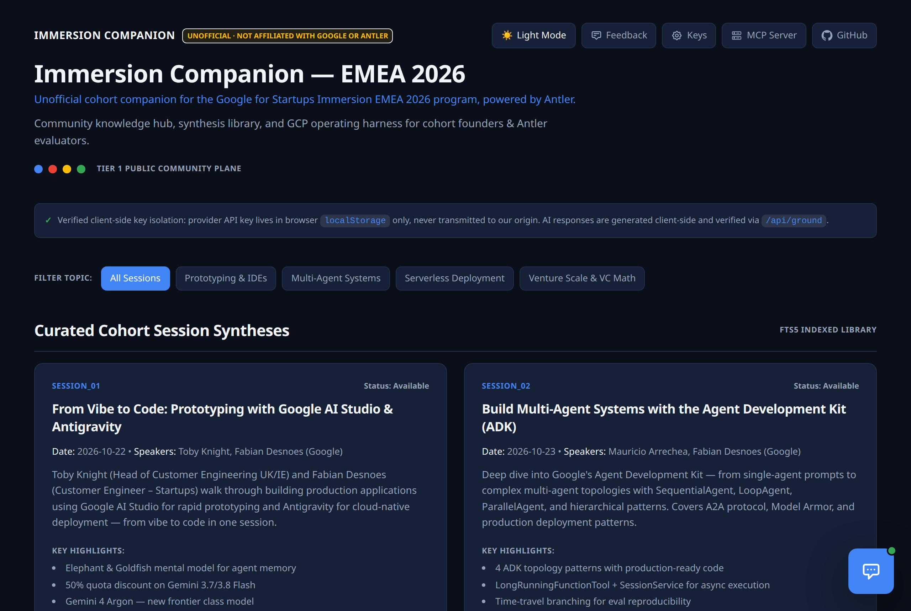
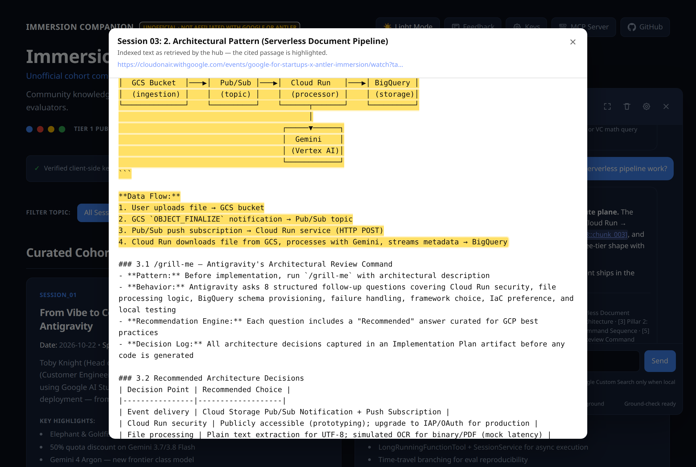
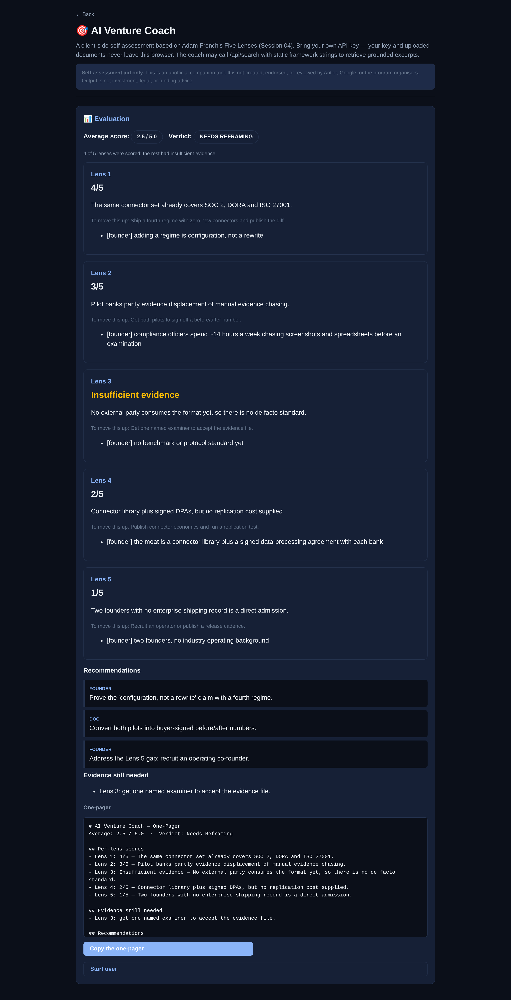

# What the portal looks like

A short, key-free tour for reviewers who don't want to configure an LLM provider key first.
Everything here is a **static snapshot** of the real portal; the live portal generates answers with
*your own* provider key (bring-your-own-key — the key never leaves your browser).

## Try the assistant without a key

Open **[`docs/demo/answer-example.html`](demo/answer-example.html)** in a browser (no server needed).
It is a frozen, self-contained snapshot of a grounded answer: click a citation like
`[session:session_03::chunk_003]` and the original indexed text opens with the cited passage
highlighted.

## Screenshots

### The cohort hub
Search across the four session syntheses, the methodology kit, and the Google Cloud documentation the
hub was built from.

### A grounded assistant answer
Every claim carries a citation back to an indexed excerpt, and the footer states the evidence status
("✓ Grounding check passed · Sources: N"). If the excerpts don't support an answer, the assistant
says so instead of guessing.

### Click a citation → the original text, with the cited chunk highlighted
Citations are clickable. The modal shows the **indexed text as retrieved** (not a fresh web fetch),
so you can verify exactly what the answer was grounded in, plus a link to the original source.

### AI Venture Coach — client-side self-assessment
A five-lens evaluation of your own venture. Scores are computed by the tool, every lens carries its
evidence ledger, and a lens with no supporting material is reported as *insufficient evidence*
rather than scored.

## What you need to run it yourself

- **Browsing the knowledge base, search, session syntheses, methodology kit:** no key at all.
- **The assistant and the coach:** a provider base URL + key (any OpenAI-compatible endpoint, or your
  own). Paste it in the settings panel; it is stored in `localStorage` only.
- The server side is retrieval-only: it never sees your key and never runs inference.

See the top-level [`README.md`](../README.md) for setup, and [`FREE_TIER.md`](../FREE_TIER.md) for the
free-tier deployment notes.